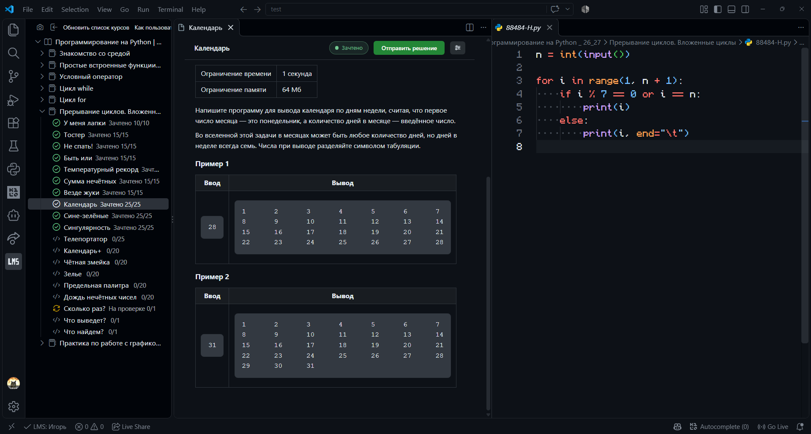
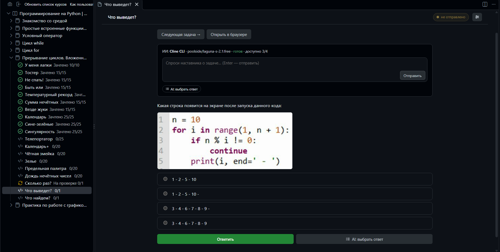
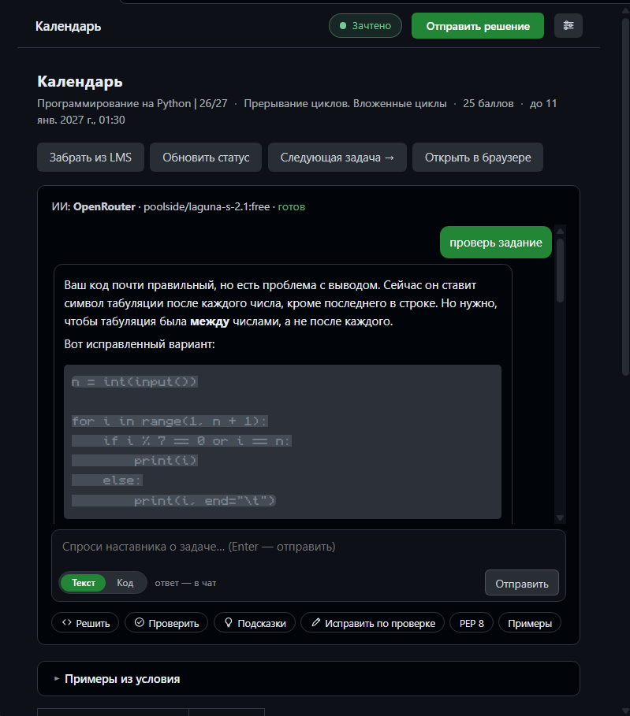
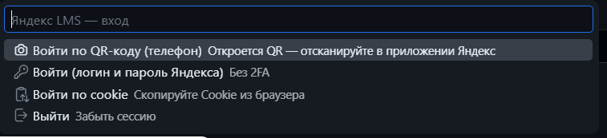

# Яндекс LMS внутри VS Code

Задания и уроки Яндекс LMS прямо в редакторе: условие слева, код справа, отправка решения одной кнопкой, ИИ-помощник, проверка PEP 8.

## Задания и решения

Два вида заданий: с кодом (условие в панели, файл решения в редакторе) и с вариантами ответа.





- **Дерево курсов** — курсы → уроки → задания со статусами: ✓ зачтено, ⟳ на проверке, ✎ на доработку.
- **Условие как на сайте** — форматирование, таблицы, картинки, в том числе картинки-ресурсы с кодом.
- **Файлы решений** — `yandex-lms/<курс>/<урок>/`, шаблон `def main(): pass` вырезается автоматически.
- **Отправка и вердикт** — одна кнопка и ожидание проверки; «Подробности»: вердикт, лог компиляции, время и память, ввод/вывод упавшего теста.
- **Плашка вердикта кликабельна** — под шапкой раскрывается причина: traceback/stderr, лог компиляции, ввод теста.
- **Задания с вариантами ответа** — вопрос, варианты, отправка своего или выбранного ИИ ответа.
- **PEP 8** — `pycodestyle`/`flake8`, а если их нет — `py_compile` и встроенные проверки.

## ИИ-помощник

Чат с ИИ живёт в панели задачи: переключатель «Текст / Код» в строке ввода решает, куда ИИ пишет ответ.



- **Чат с ИИ** прямо в панели задачи: **Текст** — ответ в чате, файл решения не трогается; **Код** — правка файла решения, ответ на вопрос уходит в код комментарием `# …`.
- **Подсказки** — пошаговый план без готового кода.
- **Проверка решения** — разбор кода и что именно не так.
- **Готовое решение** — эталонный код по условию.
- **Исправление по ошибке** — чинит код по вердикту проверки LMS.
- **Выбор ответа** — для заданий с вариантами.
- **Автодополнение** в редакторе — следующая строка решения по условию.
- **Самопроверка** — запрещённые в курсе конструкции и компиляция Python с автоисправлением; правила курса настраиваются.
- **Память ошибок** — ИИ запоминает повторяющиеся промахи и не повторяет их.
- **Провайдеры** — OpenRouter, Mistral, OpenAI, Ollama, любой OpenAI-совместимый API, локальные агенты **OpenCode CLI** и **Cline CLI** (без ключа).
- **Пул ключей** — несколько ключей и провайдеров, ротация по лимитам, «остывание» по `Retry-After`, hedge-ускорение вторым ключом.

## Установка и сборка

```bash
npm test                 # 59 юнит-тестов (node --test)
npm run package          # соберёт dist/yandex-lms-2.5.3.vsix
code --install-extension dist/yandex-lms-2.5.3.vsix
```

Артефакты сборки складываются в `dist/` (исторические версии — там же). Требуется Node.js 18+ и VS Code 1.85+.

## Вход



1. **QR-код** — `LMS: Войти по QR-коду`: сканируйте приложением Яндекса, пароль и 2FA не нужны;
2. **логин и пароль** — для аккаунтов без 2FA;
3. **cookie** — если включена 2FA: DevTools (F12) → Network → Request Headers → скопировать строку `Cookie` для lms.yandex.ru.

Куки хранятся в `SecretStorage` VS Code. API-ключи ИИ — тоже (в `settings.json` не попадают; старый ключ из настроек переносится автоматически).

## Настройки

Всё настраивается в одной панели: **шестерёнка в шапке условия**, иконка в заголовке дерева курсов или команда `LMS: Настройки`. Разделы — «Аккаунт и LMS», «ИИ: провайдеры», «ИИ: поведение», «Диагностика»; изменения сохраняются сразу, ключи можно добавлять, проверять и удалять прямо в списке.

| Параметр | Описание |
|---|---|
| `yandexLms.apiBase` | адрес LMS (по умолчанию `https://lms.yandex.ru`) |
| `yandexLms.folderName` | папка для файлов решений (по умолчанию `yandex-lms`) |
| `yandexLms.pythonPath` | путь к Python для локального запуска и PEP 8 |
| `yandexLms.pollSeconds` | сколько ждать вердикт после отправки (60) |
| `yandexLms.taskView` | `panel` / `text` / `auto` — как показывать условие |
| `yandexLms.debug` | отладка: писать логи в `%TEMP%\yandex-lms-diag` (выкл. по умолчанию) |
| `yandexLms.ai.temperature` | температура генерации |
| `yandexLms.ai.opencodeBin` | команда/путь к OpenCode CLI (`opencode`) |
| `yandexLms.ai.clineBin` | команда/путь к Cline CLI (`cline`) |
| `yandexLms.ai.courseRules` | правила курса для ИИ (пусто = встроенные правила базового курса) |
| `yandexLms.ai.autocomplete` | ИИ-автодополнение (вкл.) |
| `yandexLms.ai.autocompleteDelay` | пауза перед запросом подсказки, мс (800) |
| `yandexLms.ai.autocompleteMaxCalls` | максимум запросов к ИИ в минуту (12) |
| `yandexLms.ai.selfCheck` | самопроверка и автоисправление кода (вкл.) |
| `yandexLms.ai.hedge` / `ai.hedgeDelay` | параллельный запрос ко второму ключу (вкл. / 7000 мс) |
| `yandexLms.ai.retries` | сколько ключей пула пробовать за запрос (3) |

## Основные команды

| Команда | Действие |
|---|---|
| `LMS: Настройки` | панель настроек (всё в одном окне) |
| `LMS: Открыть задание` | условие + файл решения (`Ctrl+Alt+T`) |
| `LMS: Отправить решение` | отправить код на проверку (`Ctrl+Alt+S`) |
| `LMS: AI — ключи и провайдеры` | раздел ключей в панели настроек |
| `LMS: AI — подключить OpenCode CLI` | форма добавления с уже выбранным OpenCode |
| `LMS: AI — подсказки / проверить / решение / исправить` | помощь ИИ |
| `LMS: Ответить на задание` | выбрать вариант ответа |
| `LMS: Проверить код на PEP 8` | проверка стиля |
| `LMS: Подробности проверки` | что ответила проверка |
| `LMS: Диагностика API` / `LMS: Собрать отчёт` | диагностика соединения и эндпоинтов |
| `LMS: Условие — текстом` / `— панелью` | переключить вид условия |

## Отладка

Канал **Output → «Yandex LMS»** пишется всегда. Файлы в `%TEMP%\yandex-lms-diag` — только при включённой настройке `yandexLms.debug`; файлы старше 7 дней удаляются автоматически.

## Что изменилось в 2.5.3

**В списке заданий убран дедлайн.** Строка «до 11.01.2027» стояла в описании каждого задания и забивала список — теперь там только статус и баллы («Зачтено 25/25», «На проверке 0/1»). Сам дедлайн никуда не делся: он в подсказке при наведении на задание, в человеческом виде («Дедлайн: 11 января 2027 г.»).

## Что изменилось в 2.5.2

**Зачтённое решение больше не выглядит как «на доработку».** LMS отдаёт вердикт строчными — `ok`, — а код сравнивал его с `OK`. Из-за этого после успешной отправки:

- в дереве появлялся красный значок «на доработку», хотя решение принято;
- плашка в шапке панели была красной с сырым «ok» вместо зелёного «Зачтено»;
- уведомление показывало «LMS: ok» как предупреждение вместо «решение зачтено!».

Теперь вердикт сравнивается без учёта регистра (`ok`, `OK`, `accepted`, `accepted-after-deadline`), подписи ищутся так же, а вердикт важнее типа статуса: если LMS в списке задач пишет `rework`, а в решении вердикт `ok`, задача считается зачтённой. Для проверенных задач дерево дополнительно дотягивает вердикт из решения (по 4 задачи параллельно, чтобы не тормозить загрузку).

## Что изменилось в 2.5.1

**Исправлена отправка решения (403 на всех ручках).** Клиент искал CSRF-токен по имени куки в таблице, где ключ — `domain|path|name`, поэтому поиск всегда возвращал пусто и POST уходил без заголовка `X-CSRF-Token`. Сервер отвечал `403` на все изменяющие запросы (список курсов и задания при этом грузились — это GET). Что сделано:

- токен читается из куки правильно (при нескольких одноимённых куках берётся самая конкретная по домену);
- если куки нет (вход по QR или паролю её не получает) — расширение само забирает страницу LMS и берёт токен оттуда; то же происходит сразу после входа;
- на `403` токен обновляется и запрос повторяется один раз (без циклов), заголовки собираются заново на каждую попытку;
- в сообщении о неудаче теперь видно ответ сервера, а кнопка «Войти заново» открывает меню входа.

## Что изменилось в 2.5

**Чат с ИИ: два режима в строке ввода.** Переключатель «Текст / Код» стоит прямо в поле ввода (не отдельной панелью над ним), выбор запоминается между сессиями:

- **Текст** — нейросеть работает только с окном чата: ответ приходит сообщением в панель, файл решения не трогается;
- **Код** — нейросеть работает только с файлом решения и пишет только туда. Файл обязан измениться при каждом запросе: если вы задали вопрос, ответ уходит в код комментарием `# …` (или строкой в тройных кавычках). Метка времени в заголовке комментария гарантирует, что даже повторный одинаковый вопрос изменит файл, а не оставит «пустую» правку;
- после записи расширение проверяет, что код компилируется, и предупреждает в чате, если нет;
- при переключении режима черновик сообщения не теряется, фокус возвращается в строку ввода.

## Что изменилось в 2.4

**Настройки — в одном окне.** Раньше каждый параметр и каждый ключ настраивались цепочкой «пункт в палитре → поле ввода → ещё поле». Теперь есть панель с разделами и нормальными контролами:

- **ключи ИИ** — списком: маска ключа, модель, адрес, название; кнопки «Список» моделей, «Проверить», «Сделать основным», «Удалить»; общий «Проверить все» и «Сбросить лимиты»;
- **добавление провайдера** — формой (провайдер, адрес, ключ, модель с подсказками из API); для OpenCode/Cline — путь к бинарнику с проверкой версии;
- **поведение ИИ** — переключатели и числовые поля с единицами измерения, правила курса в многострочном поле;
- **поиск по настройкам** и ссылка на `settings.json` — в шапке панели.

Заодно id ключей в пуле стали стабильными: правка модели или ключа больше не отвязывает «основной» ключ, замеры времени и кулдауны.

## Что изменилось в 2.2

**Возвращено автозакрытие вкладок** (убрано в 2.0 как «навязчивое» — оказалось, это и был рабочий процесс):
- клик по иконке LMS закрывает все вкладки редактора (изменения сначала сохраняются) — остаётся только панель условия;
- открытие новой задачи закрывает окно кода предыдущей — одна задача, одно окно;
- заданиям с вариантами ответа окно кода не открывается, а прежнее закрывается;
- временные вкладки «условие.md» подчищаются, когда живёт панель условия.

## Что изменилось в 2.1

**Интерфейс**
- **липкая шапка панели задания**: статус решения (пилюля Зачтено/Ошибка/не отправлено) и кнопка «Отправить решение» не уезжают при прокрутке условия;
- блоки «Подробности проверки» и «Проверка PEP 8» свернулись в аккуратные раскрывающиеся секции — условие больше не тонет в служебной информации;
- кнопки действий с векторными иконками в стиле codicon вместо эмодзи; статус в шапке — человекочитаемый вердикт («Неверный ответ» вместо `wrong-answer`);
- карточки вариантов ответа с подсветкой выбранного, типографика условия (код, цитаты, таблицы, картинки с рамкой), ограничение ширины строки для комфортного чтения;
- приветственный экран переделан: карточки входа, нумерованные шаги, подсказка на случай бага webview;
- единый стиль кнопок (главная/второстепенная/AI) в обеих темах VS Code.

**Новое**
- кнопка **«Следующая задача →»** в панели — открывает следующую задачу урока без возврата в дерево;
- **картинки-ресурсы** (`{resource:N}` — картинки с кодом) в заданиях с вариантами ответа подгружаются и показываются вместо текста-заглушки;
- команды «Условие — панелью» / «— текстом» переключают вид на лету.

## Что изменилось в 2.0

**Убрано опасное и навязчивое**
- расширение больше **не закрывает вкладки редактора** (раньше при клике на панель LMS закрывались все открытые файлы);
- убит скрипт «саморемонта» с `taskkill /F` и удалением кэша профиля VS Code — вместо него обычная команда «перезагрузить webview» и текстовый вид условия;
- **нет фонового обхода всех курсов** при старте (раньше сотни запросов к API каждое открытие окна); скан картинок остался командой;
- отправка решения больше не «обстреливает» ~20 эндпоинтов наугад: основной + два проверенных фолбэка;
- у всех запросов к LMS появились таймауты — зависший сервер не вешает расширение.

**Приватность**
- логи в `%TEMP%` пишутся только при `yandexLms.debug`; авто-чистка старых файлов;
- API-ключи только в SecretStorage (легаси-ключ из settings.json переносится при первом запуске).

**Архитектура**
- монолит `extension.js` (4868 строк) разбит на модули `src/`: `client`, `cookies`, `lms`, `panel`, `tree`, `markers`, `autocomplete`, `webviews`, `diag`, `ai/*`;
- 17 юнит-тестов (`npm test`): CookieJar, шаблоны, markdown, линтер курса, дымовой тест загрузки модулей;
- правила курса для ИИ вынесены в настройку `yandexLms.ai.courseRules`.

**Новое**
- **OpenCode CLI** как провайдер ИИ: без ключей, модели из `opencode models`, выбор агента, участие в ротации пула;
- статус ИИ в панели условия показывает и CLI-провайдеров.

## Известная особенность VS Code 1.142+

При перезагрузке окна первый webview может не загрузиться (`Could not register service worker: InvalidStateError`, [microsoft/vscode#342842](https://github.com/microsoft/vscode/issues/342842) — баг VS Code, ломает и встроенные расширения). Расширение справляется в три ступени:

1. если панель не сообщила о загрузке за 3,5 секунды, она пересоздаётся со свежим service-worker scope (до 2 попыток);
2. если не помогло — условие автоматически показывается текстом через markdown-preview; сломанное состояние запоминается, и при следующих перезагрузках окна панель не открывается (ошибка не появляется) — работают кнопки «Панель снова» / «Починить webview»;
3. если баг повторяется в каждом окне (кэш service worker побит) — команда **`LMS: Починить webview (очистить Service Worker)`**: вы закрываете VS Code сами (без принудительного убийства процесса), скрипт чистит `%APPDATA%\Code\Service Worker`, `Code Cache` и `GPUCache` и запускает VS Code обратно. Если VS Code не закрыт в течение 10 минут, скрипт молча выходит, ничего не удаляя.

## Лицензии

MIT — см. [LICENSE](LICENSE). В `media/qrcode.min.js` — qrcode-generator (Kazuhiko Arase, MIT).
